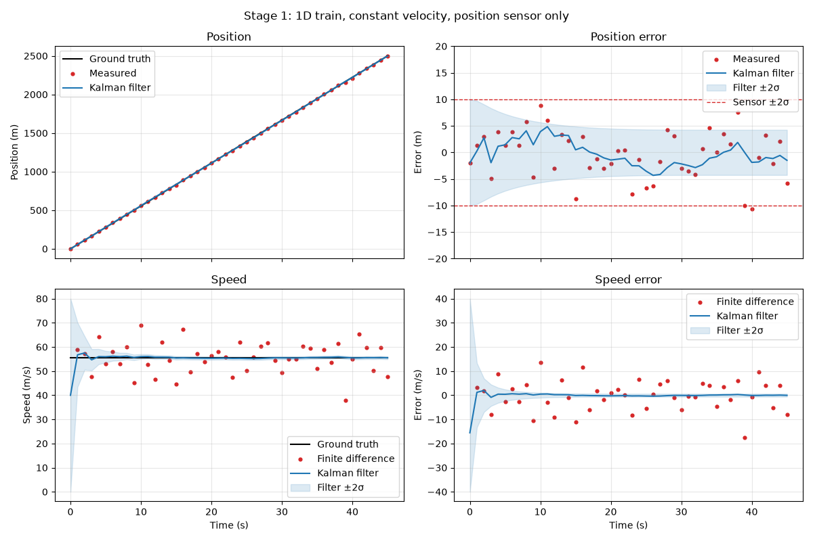
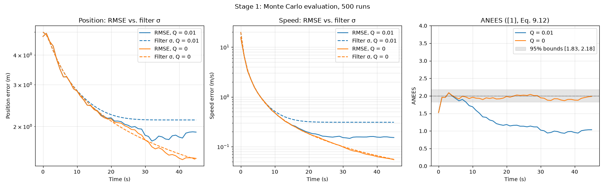
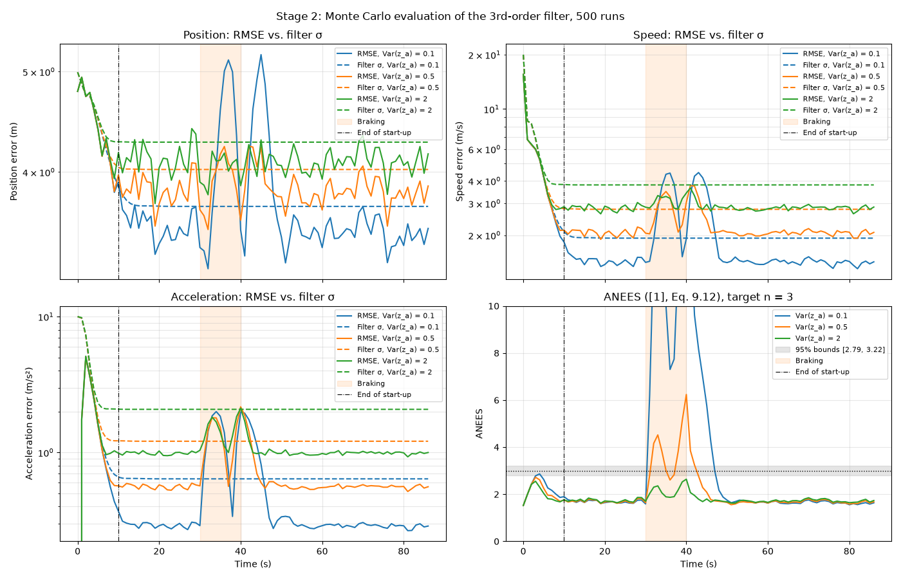
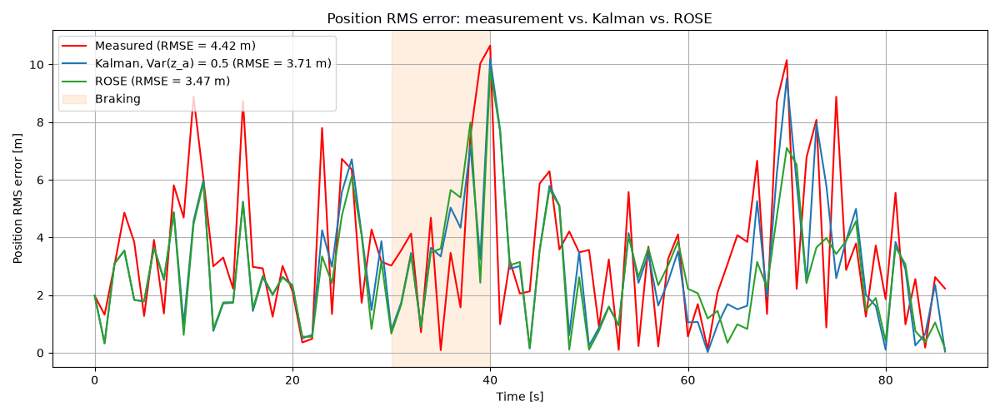
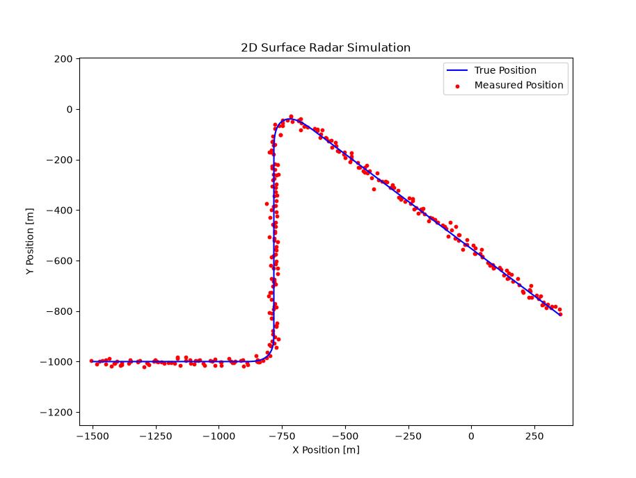

# Kalman Tracking

[](https://github.com/olemeif/kalman-tracking/actions/workflows/python-tests.yml)

A learning project on state estimation and target tracking. It starts with a 1D Kalman filter for a train on a straight track and builds step by step towards a 2D/3D multi-target radar tracker with systematic performance evaluation.

The filters are developed in Python first and then ported to C++. Python remains the layer for simulation, evaluation and plotting.

## Project status
 
| Stage | Content | Status |
| ----- | ------- | ------ |
| 1 | 1D Kalman filter (constant velocity), Monte Carlo consistency evaluation (RMSE vs. filter σ, ANEES) | **Done** |
| 2 | Braking scenario, 3rd-order model, ROSE filter. | **Done** |
| 3 | 2D Surface Radar tracking of a single target, constant velocity, changing direction | **In progress** |
| 4 | Radar measurements (range, bearing): Extended Kalman filter | Planned |
| 5 | Changing speed, finding a good model for a maneuvering target (ROSE, IMM) | Planned |
| 6 | Multi-target tracking: clutter, missed detections, gating, data association, track management | Planned |
| 7 | Validation: scenario library and metrics (RMSE, NEES, track continuity, ID switches, false tracks) | Planned |
| 8 | Port of filters and tracker to C++ (library, unit tests, benchmarks) | Planned |
| 9 | Evaluation on real trajectories (e.g. PX4 flight logs, public AIS data) | Planned |
 
Each stage ends with a documented evaluation, not just working code. The goal is to show *how well* a tracker works and *why*, not only that it runs.

## Setup (Python)

Requires Python 3.13 or newer.

Clone the repository then navigate to the project directory, create a virtual environment and install the dependencies:

```sh
python -m venv .venv
source .venv/bin/activate      # Windows: .venv\Scripts\activate
```

```sh
cd python
python main.py <scenario> [mode]
```

| Scenario | Content |
| -------- | ------- |
| `train` | Stage 1: constant speed, 2nd-order filter |
| `decel` | Stage 2: braking train, 3rd-order filter |

| Mode | Content |
| ---- | ------- |
| `run` (default) | one noise realization (seed from the scenario file) with plots |
| `mc` | Monte Carlo evaluation: RMSE, filter σ and ANEES |

For example `python main.py decel mc`. `python main.py --all` runs every scenario in both modes.

If you get `ModuleNotFoundError: No module named 'helpers'`, the virtual environment is not active or `pip install -e .` has not been run.

## Stage 1: 1D Kalman filter for a train on a straight track

A train moves along a straight track of length $\ell$ at a constant speed $v_0$. A position sensor measures the train's position every $T_s$ seconds with Gaussian noise. A Kalman filter with a 2nd-order kinematic model (constant-velocity model, [1], Sec. 12.2) estimates position **and** speed, although the speed is never measured.
 
### Model
 
```math
\mathbf{x}(k) = \begin{bmatrix} s(k) \\ v(k) \end{bmatrix}, \qquad
\mathbf{A}_d = \begin{bmatrix} 1 & T_s \\ 0 & 1 \end{bmatrix}, \qquad
\mathbf{C} = \begin{bmatrix} 1 & 0 \end{bmatrix}, \qquad
R = \sigma^2
```
 
([1], Eq. 12.3, 12.4 and 1.18). Filter equations: [1], Eq. 12.24–12.28, in the order *correct with measurement k, then predict to k+1*.
 
**Process noise.** [1], Sec. 12.2 gives three ways to discretize it. All three are implemented, written with $\text{Var}(z_v)$, the velocity change per step:
 
**Method 1: direct discretization** ([1], Eq. 12.11)
 
```math
\mathbf{G}_d \mathbf{Q} \mathbf{G}_d^T = \begin{bmatrix} T_s^2 & T_s \\ T_s & 1 \end{bmatrix} \text{Var}(z_v)
```
 
**Method 2: piecewise constant noise** ([1], Eq. 12.17), used for the results below
 
```math
\mathbf{G}_d \mathbf{Q} \mathbf{G}_d^T = \begin{bmatrix} T_s^2/4 & T_s/2 \\ T_s/2 & 1 \end{bmatrix} \text{Var}(z_v)
```
 
**Method 3: discretized continuous model** ([1], Eq. 12.19)
 
```math
\mathbf{G}_d \mathbf{Q} \mathbf{G}_d^T = \begin{bmatrix} T_s^2/3 & T_s/2 \\ T_s/2 & 1 \end{bmatrix} \text{Var}(z_v)
```
 
### Parameters
 
| Scenario | Value |
|---|---|
| Track length $\ell$ | 2,500 m |
| Initial position $s_0$ | 0 m |
| Speed $v_0$ | 55.55 m/s (200 km/h) |
| Sampling time $T_s$ | 1.0 s |
| Measurement noise $\sigma$ | 5.0 m |
| Random seed | 31 |
 
| Filter | Value |
|---|---|
| Measurement noise $R$ | $\sigma^2$ = 25 m² (matches the simulation) |
| Process noise $\text{Var}(z_v)$ | 0.01 (m/s)², method 2 (Eq. 12.17) |
| Initial state $\hat{\mathbf{x}}_0$ | $[s_{\text{meas}}(0),\ 40\ \text{m/s}]^T$ (speed deliberately wrong) |
| Initial covariance $\hat{\mathbf{P}}_0$ | $\text{diag}(100^2\ \text{m}^2,\ 20^2\ (\text{m/s})^2)$ |

### Results



The speed baseline is the finite difference of consecutive position measurements, $(y(k) - y(k-1))/T_s$. RMSE over a single run (seed 31):
 
| RMSE | Raw sensor / finite difference | Kalman filter |
|---|---|---|
| Position, all steps | 4.56 m | 2.29 m |
| Position, after convergence ($k \geq 5$) | 4.70 m | 2.34 m |
| Speed, all steps | 6.32 m/s | 2.34 m/s |
| Speed, after convergence ($k \geq 5$) | 6.33 m/s | 0.26 m/s |

**Observations**
 
- **Speed without a speed sensor.** Starting from 40 m/s (true: 55.55 m/s), the estimate converges within about 3 s. The overall speed RMSE is dominated by this start-up; after convergence the filter is about 25× more accurate than the finite difference.
- **Position.** The filter roughly halves the position error. Its ±2σ band shrinks from the sensor's ±10 m to about ±4.3 m.

These numbers come from one noise realization only. Whether the ±2σ bands are actually right (filter consistency) needs many runs; see the Monte Carlo evaluation below.

### Monte Carlo evaluation

The same experiment is repeated $N = 500$ times with seeds $0, \dots, N-1$. Errors are averaged **across runs, not across time**, which gives one value per time step and shows how the filter converges.

- **RMSE vs. filter σ.** The RMSE over all runs is compared with the filter's own claim, $\sqrt{\tilde{P}_{ii}}$. For a consistent filter, the two curves lie on top of each other.
- **ANEES** ([1], Eq. 9.7 and 9.12). For each run and step, $\varepsilon(k) = \tilde{\boldsymbol{\varepsilon}}^T \tilde{\mathbf{P}}^{-1} \tilde{\boldsymbol{\varepsilon}}$ uses the full covariance, because position and speed errors are correlated. Averaged over $N$ runs, $N \cdot \bar{\varepsilon}$ follows a $\chi^2$ distribution with $N \cdot n$ degrees of freedom ($n = 2$ states). The 95% bounds are $[r_1, r_2] = [1.83,\ 2.18]$ ([1], Eq. 9.13). A consistent filter stays around $n = 2$, inside the bounds.

Two process noise values are compared: the value from the single run, $\text{Var}(z_v) = 0.01$, and $\text{Var}(z_v) = 0$, which matches the simulation exactly (the speed never changes).



Averaged over the second half of the run ($t \geq 23$ s):

| $\text{Var}(z_v)$ | Position RMSE / filter σ | Speed RMSE / filter σ | ANEES | Steps inside bounds |
|---|---|---|---|---|
| 0.01 (m/s)² | 1.88 m / 2.14 m | 0.157 m/s / 0.309 m/s | 1.03 | 15% |
| 0 | 1.67 m / 1.68 m | 0.089 m/s / 0.090 m/s | 1.94 | 98% |

**Observations**

- **$\text{Var}(z_v) = 0.01$ is too pessimistic.** The filter allows for speed changes that never happen. Its σ levels off while the actual error keeps falling, so it claims about twice the actual speed error. The ANEES drops below the lower bound at about 9 s and ends near 1.0.
- **$\text{Var}(z_v) = 0$ is consistent.** RMSE and σ coincide for both states, and the ANEES stays around 2 throughout. It is also the more accurate filter: the model matches the simulation, so every measurement keeps refining the speed.
- **Start-up.** Both filters agree for the first ~10 s, where the large initial covariance $\hat{\mathbf{P}}_0$ dominates. At $k = 0$, the ANEES is about 1.5, because $\hat{\mathbf{P}}_0$ is deliberately generous.
- **Why not use 0 in practice?** With $\text{Var}(z_v) = 0$, the gain goes to zero and the filter could never follow a real speed change. In practice, a small $\text{Var}(z_v) > 0$ is chosen, accepting a slightly conservative (but safe) filter. An *overconfident* filter, with the σ curve below the RMSE, would be the dangerous case.

The 46-step track is short, so neither filter reaches a true steady state; with $\text{Var}(z_v) = 0$, the covariance keeps shrinking until the end.

## Stage 2: Braking train, 3rd-order model

The train from Stage 1 now brakes from 55.55 m/s to 40 m/s. The constant-velocity model cannot follow this: with any fixed $\text{Var}(z_v)$, it is either overconfident during braking or too pessimistic at constant speed. A 3rd-order kinematic model ([1], Sec. 12.3) adds the acceleration to the state, so the filter can estimate the deceleration itself, still from position measurements only.

### Scenario

The speed follows a raised cosine, so the acceleration is continuous:

```math
v(t) = v_0 - \frac{\Delta v}{2}\left(1 - \cos(\pi\tau)\right), \qquad
a(t) = -\frac{\Delta v}{2} \cdot \frac{\pi}{T} \sin(\pi\tau), \qquad
\tau = \frac{t - t_{\text{start}}}{T} \in [0, 1]
```

| Scenario | Value |
|---|---|
| Track length $\ell$ | 4,000 m |
| Speed | 55.55 m/s → 40 m/s ($\Delta v$ = 15.55 m/s) |
| Braking start $t_{\text{start}}$, duration $T$ | 30 s, 10 s |
| Deceleration, mean / peak | 1.55 m/s² / 2.44 m/s² ($a_{\max} = \pi \Delta v / 2T$) |
| Max. rate of change of deceleration | 0.77 m/s³ ($\pi^2 \Delta v / 2T^2$) |
| Sampling time $T_s$, measurement noise $\sigma$ | 1.0 s, 5.0 m |

### Model

```math
\mathbf{x}(k) = \begin{bmatrix} s(k) \\ v(k) \\ a(k) \end{bmatrix}, \qquad
\mathbf{A}_d = \begin{bmatrix} 1 & T_s & T_s^2/2 \\ 0 & 1 & T_s \\ 0 & 0 & 1 \end{bmatrix}, \qquad
\mathbf{C} = \begin{bmatrix} 1 & 0 & 0 \end{bmatrix}
```

([1], Eq. 12.29). Process noise with method 1, direct discretization ([1], Sec. 12.3, p. 138):

```math
\mathbf{G}_d \mathbf{Q} \mathbf{G}_d^T = \begin{bmatrix} T_s^4/4 & T_s^3/2 & T_s^2/2 \\ T_s^3/2 & T_s^2 & T_s \\ T_s^2/2 & T_s & 1 \end{bmatrix} \text{Var}(z_a)
```

$\text{Var}(z_a)$ is now the change in **acceleration** per step, in (m/s²)², so the values from Stage 1 do not carry over.

| Filter | Value |
|---|---|
| Measurement noise $R$ | $\sigma^2$ = 25 m² |
| Process noise $\text{Var}(z_a)$ | 0.1, 0.5 and 2 (m/s²)², compared |
| Initial state $\hat{\mathbf{x}}_0$ | $[s_{\text{meas}}(0),\ 40\ \text{m/s},\ 0\ \text{m/s}^2]^T$ |
| Initial covariance $\hat{\mathbf{P}}_0$ | $\text{diag}(100^2\ \text{m}^2,\ 20^2\ (\text{m/s})^2,\ 10^2\ (\text{m/s}^2)^2)$ |

### Monte Carlo evaluation



$N = 500$ runs. With $n = 3$ states, a consistent filter has an ANEES around 3; the 95% bounds are $[2.79,\ 3.22]$. Errors after start-up ($k \geq 10$), braking phase included:

| Filter | Position RMSE (m) | Speed RMSE (m/s) | Acceleration RMSE (m/s²) | ANEES max | ANEES median |
|---|---|---|---|---|---|
| Raw sensor / finite difference | 4.98 | 7.04 | – | – | – |
| 3rd order, $\text{Var}(z_a)$ = 0.1 | 3.72 | 2.01 | 0.70 | 25.41 | 1.69 |
| 3rd order, $\text{Var}(z_a)$ = 0.5 | 3.86 | 2.26 | 0.79 | 6.24 | 1.69 |
| 3rd order, $\text{Var}(z_a)$ = 2 | 4.09 | 2.89 | 1.09 | 2.64 | 1.73 |

**Observations**

- **The same trade-off as in Stage 1, one level up.** $\text{Var}(z_a)$ = 0.1 is the most accurate at constant speed but overconfident during braking (ANEES up to 25). $\text{Var}(z_a)$ = 2 stays inside the upper bound throughout, but is noisier everywhere. No fixed value is right for both phases.
- **The filter lags, then overshoots.** For $\text{Var}(z_a)$ = 0.1, the position error peaks at about 5 m twice: around t = 36 s, just after the strongest deceleration, and around t = 45 s, after braking has ended. The model assumes a nearly constant acceleration, so its acceleration estimate trails the truth by several seconds: first it brakes too little, then it keeps braking after the train has stopped decelerating.
- **Conservative at constant speed.** The ANEES median is about 1.7 for all three values, below the lower bound of 2.79. Any $\text{Var}(z_a) > 0$ lets the filter expect accelerations that do not happen while the speed is constant.
- **The price of a more flexible model.** At constant speed, the position error is about 3.4–4 m, compared with about 1.7–1.9 m for the constant-velocity filter in Stage 1. Estimating a third state that is mostly zero costs accuracy.
- **The limit is the information, not the tuning.** With ±5 m position measurements at 1 Hz, the data holds little information about a maneuver this fast. A better motion model alone cannot create it; an additional measured quantity can (see next steps).

### Increasing the accuracy (ROSE, IMM)

To increase the accuracy, the algorithm can be extended to either a **ROSE** (Rapid Ongoing Stochastic covariance Estemation filter, [1], Sec. 6) or an **IMM** (Interacting Multiple Model Algorithm, [2]).

#### ROSE

> [!NOTE]
> The ROSE explanation is still missing in this document. I will do it another time.



Position error over a single run (seed 31), raw measurement, Kalman filter with $\text{Var}(z_a)$ = 0.5 and ROSE on the same measurements:

| | Measured | Kalman, $\text{Var}(z_a)$ = 0.5 | ROSE |
|---|---|---|---|
| Position RMSE, all steps | 4.42 m | 3.71 m | 3.47 m |

The effect of the filter is small when the train is changing speed.
This could be improved by also adding a speed measurement (Doppler GNSS), but for this example that would be too much information. The goal is to show how the filter behaves with only position measurements.

Another option is to use an **IMM** with two models: one for constant speed and one for braking. The IMM can switch between the two models based on the measurements, potentially improving accuracy during maneuvers.

This will be skipped for now. First a tracker for a 2D scenario with changing direction will be implemented, which is more interesting than a 1D scenario with only one maneuver. Later, with changing speed, I may come back to this problem. 

## Stage 3: 2D Surface Radar tracking of a single target, constant velocity, changing direction

This stage is a closer-to-real-life scenario: a 2D surface radar tracks a single target moving at constant speed but changing direction.
The radar provides position measurements in the x-y plane, the filter estimates the target's position.

The standard deviation of the radar measurement noise was set to 10m.

For the target trajectory, a 90° left and a ~82° right turn were chosen, with straight segments before, between and after the turns. The target speed is constant at 10 m/s.




## Notation
 
This project follows the notation of [1]:
 
| Symbol | Meaning |
|---|---|
| $s$, $v$, $a$ | position, velocity, acceleration |
| $\mathbf{A}_d$, $\mathbf{B}_d$ | discrete system and input matrix |
| $\mathbf{C}$ | measurement matrix (often $\mathbf{H}$ in English literature) |
| $y$ | measurement |
| $\hat{\mathbf{x}}$, $\hat{\mathbf{P}}$ | **predicted** state and covariance |
| $\tilde{\mathbf{x}}$, $\tilde{\mathbf{P}}$ | **corrected** state and covariance |
| $\mathbf{Q}$, $\mathbf{R}$ | process and measurement noise covariance |
 
> [!NOTE]
> Many English sources use $\hat{\mathbf{x}}$ for the *corrected* estimate.
 
## References
 
[1] R. Marchthaler, S. Dingler: *Kalman-Filter. Einführung in die Zustandsschätzung und ihre Anwendung für eingebettete Systeme*, 2nd ed., Springer Vieweg, 2024. https://doi.org/10.1007/978-3-658-43216-4

[2] A. F. Genovese: **The Interacting Multiple Model Algorithm for Accurate State Estimation of Maneuvering Targets**, Johns Hopkins APL Technical Digest, Volume 22, Number 4, 2001.
